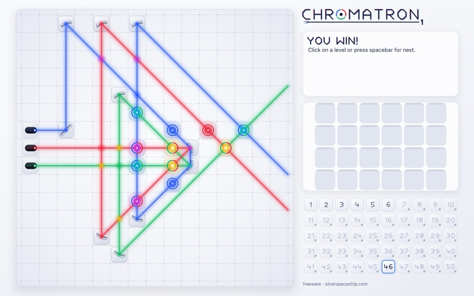
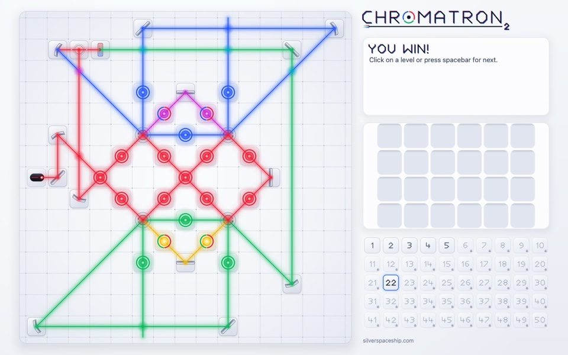
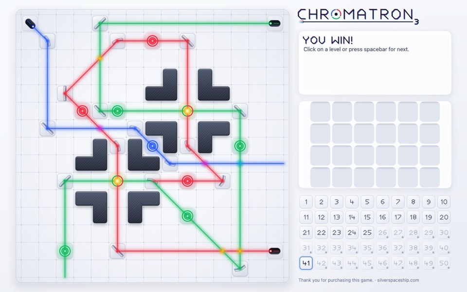
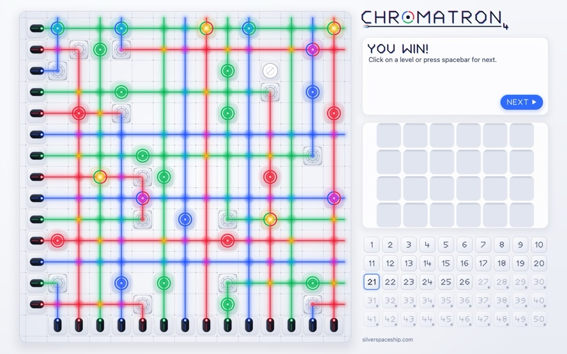

+++
authors = ["Shengtuo Hu"]
title = "Playing Chromatron Again, Twenty Years Later"
description = "I played Chromatron with my dad around 2006. Twenty years later, Claude Code and I reverse-engineered all four games, ported them to Apple Silicon and WebAssembly on one Rust engine, and gave them a new look."
date = 2026-10-11T18:00:00-07:00
[taxonomies]
tags = ["Chromatron", "Claude Code", "Reverse Engineering", "Rust", "Games"]
[extra]
card = "card.png"
card_fit = "fill"
banner = "banner.jpg"
actions = [
  { url = "https://shengtuo.me/chromatron-remake/", name = "Play it in your browser" },
  { url = "https://github.com/h1994st/chromatron-remake/releases/latest", name = "Get the Mac apps" },
]
+++

<section class="f-hero site-play">

Play now · free

Chromatron 1–4, in your browser

All four games, no install, phones included. The same engine runs natively on Apple Silicon.

<a class="f-btn f-btn--primary" href="https://shengtuo.me/chromatron-remake/">Play it now</a>
<a class="f-btn" href="https://github.com/h1994st/chromatron-remake/releases/latest">Mac apps</a>
<a class="f-btn" href="https://github.com/h1994st/chromatron-remake">Source</a>

</section>

Around 2006, my dad and I played a little puzzle game called Chromatron. You get a
few lasers, some mirrors and color filters, and a board of targets that light up
when the right color of light reaches them.

The version we played was not Sean Barrett's original, though. It was a Flash
port by Hawkpeng79, and it only covered the first Chromatron, split into two
Flash games of 25 levels each. That is why, for twenty years, I never knew there
were three more.

Recently I wanted to play it again. Sean Barrett's site still has all four
Chromatron games up for download, but none of them would open on my Mac. So
Claude Code and I brought them back, in three parts:

1. **Reverse engineering** the original programs, since there is no source code.
2. **Porting** them to one Rust engine that runs natively on Apple Silicon and,
   as WebAssembly, in any browser.
3. **Redesigning** the look, with the classic one kept a switch away.

Claude Code wrote all of the code. I set the direction, made the calls, and
played every build. By the next evening I was playing all four games, and the
early levels of the first one came back as pure muscle memory.



The trailer. Its puzzles were made new for the video, not taken from the original levels.

## The game in one picture

<figure class="f-figure f-figure--bare">

<figcaption>Steer colored lasers with mirrors and filters, and mix the light so every target gets exactly its color.</figcaption>
</figure>

Each level gives you some fixed pieces and a toolbox of movable ones. You drag
them onto the grid and turn them in 45° steps. Light mixes the way light does, so
red and green make yellow, and a target only lights up when it gets exactly its
own color. A level is solved when every target is lit at the same time. Each
sequel adds stranger pieces: twisters in Chromatron 2, quad-benders in 3, logic
gates and teleporters in 4.

## Reverse engineering

The Mac versions came out in 2003 and 2004, built for PowerPC. Apple moved to
Intel in 2006 and kept PowerPC apps running through Rosetta until Mac OS X Lion
dropped it in 2011. On an Apple Silicon Mac today, they are icons that refuse to
launch.

We set two ground rules. Everything comes from our own reading of the original
programs, not from anyone else's port. And no game data goes into the
repository: the build reads it from the originals, downloaded from Sean's site
and pinned by their SHA-256 hashes.

What we found inside:

- Each game is a single 32-bit, big-endian PowerPC Mach-O executable of 77 to
  94 KB. There are no resource files: the levels, hints, sprites and palette all
  sit in the program's own data section.
- Sprites are 24×24 pixels with 8-bit color, packed with PCX-style run-length
  encoding. Every palette value is a multiple of 4, the habit of a 6-bit VGA
  palette.
- The game draws everything itself into a 640×480 image and hands the whole frame
  to the system on every redraw. It never asks the system for a clock, a timer,
  random numbers or sound, so the original has no animation at all.

We ran Ghidra headless to decompile the PowerPC code into C. Subagents read the
output and wrote notes on how each game works, about 6,200 lines in all. Only
Chromatron 2 was read against the first game; 3 and 4 were read against 2, by
comparing their code with the addresses masked out, so only real changes showed. The decompiler was not always right. It dropped
arguments from a system call and turned a byte swap into a meaningless mask, so
we checked such spots against the raw disassembly in radare2.

The best check came from the data itself. Every level stores its movable pieces
in their solved spots, and the game sweeps them into the toolbox when the level
opens. So each level is its own test: all of them win from their stored
placement, except Chromatron 1's level 16, whose mirror is stored a little off.

Along the way we found things I would never have known about otherwise:

- Chromatron 1 has 62 levels inside it, but only 50 are playable. The other 12
  are still there, and they still solve. Chromatron 3's unused levels have
  placeholder names like "level005", with hints that just say "foobar" and
  "blah".
- Chromatron 3 already has Chromatron 4's logic gate, starburst and movable
  teleporter fully built in, used only by levels you cannot reach.
- Each game has a hidden key that wins the level on the spot, and it is a
  different key in each: `L`, `z`, `^` and Ctrl-O.
- The order of pieces in the toolbox comes from the C library's `qsort`, which
  does not keep ties in order. To match it, the port carries its own copy of
  FreeBSD's `qsort`, the one Mac OS X's C library was built from.
- The "silverspaceship.com" at the bottom of the screen is not stored as plain
  text. Each byte is XORed with the one before it, the same way in all four games.
- If you let go of a piece outside the window, the original could later let you
  drag a wall or a laser. The port cancels the drag instead.

Lately a project called [REA (Reverse Engineer Anything)](https://github.com/morluto/rea)
has been trending on GitHub. It connects coding agents to Ghidra, IDA Pro and
Hopper so they can take a program apart and rebuild it. We did not use it;
Claude Code drove Ghidra from the command line. But it is the same idea: an old
program you can no longer run does not have to be the end of it.

## Porting: one engine, two platforms

<figure class="f-figure f-figure--bare">
<picture>
<source media="(max-width: 600px)" srcset="how-tall.svg" width="360" height="700">

</picture>
<figcaption>Drawn as a Chromatron board: the original game is the white light, the Rust engine is the prism, and the green beam is me.</figcaption>
</figure>

This was never only a port from PowerPC to Apple Silicon. The same Rust engine
is built twice: as four native apps for Apple Silicon Macs, and as WebAssembly
for the browser. It is split into layers:

- `spectrograph` decodes the original programs. Each app's build script runs it
  and embeds the game as Rust data, so nothing is parsed at run time.
- `lumen` is the game: the beam tracer, the piece rules, the win check, and the
  save and clipboard formats. It knows nothing about any platform. What differs
  between the four games, from the beam limit to the save file's bit order, is
  data in one `RuleSet`.
- `halation` draws the new look (more on it below).
- Two thin shells sit on top. On the Mac, it is winit, menus rebuilt from the
  original's menu file, and Core Text. On the web, it is a canvas, touch controls
  and a little plain JavaScript, with no bundler.

The browser version is the full game, not a lite edition. The WebAssembly is
252 KB compressed, and the whole page, all four games included, is under 300 KB.
Saves and copied solutions keep the original formats, so a solution copied in
the browser pastes straight into the Mac app. One small catch on the way: Rust's
standard clock panics in the browser, so the shells pass the time in instead.

We worked the way a careful team would: a design first, then plans split into
tasks, each built by one Claude subagent and checked by another. The first game
was playable on my Mac the same night. All four Mac apps shipped the next
evening, and the browser version the morning after that.

## Redesign: a new look

<label><input type="radio" name="chromatron-look" value="modern" checked>Dark</label>
<label><input type="radio" name="chromatron-look" value="light">Light</label>
<label><input type="radio" name="chromatron-look" value="classic">Classic</label>

<ul class="f-gallery">
<li>Chromatron</li>
<li>Chromatron 2</li>
<li>Chromatron 3</li>
<li>Chromatron 4</li>
</ul>

A few days after the first release, we gave the remake a new look built around
the light, starting from the style of our trailer. Beams sweep out from their
lasers, targets flash as they light up, and pieces lift and turn as you move
them. It runs in the browser and in the Mac apps, with a light theme that follows
your system.

- **It draws everything itself.** `halation` is a small rasterizer written for
  this game, with no graphics library and no GPU, so the browser and the Mac
  paint the same pixels. Off-the-shelf options were too big for the web or would
  have meant drawing all the art twice.
- **Light behaves like light.** In the dark theme, beams add up, with a glow and
  a bloom computed at lower resolution and a soft limit so busy crossings do not
  go flat white. On a light board, added light would vanish, so the light theme
  paints beams over the board and works out the mixed color at every crossing.
- **Light arrives in order.** A beam that splits, crosses itself or comes back
  along its own path has to light up the way light would actually travel. Our
  first two attempts got some levels visibly wrong. The third follows the game's
  own rules, and it is checked against every original level.
- **Nothing changed by accident.** The classic pixels stayed byte for byte the
  same through the whole redesign. Every speed-up was checked against about 3,300
  hashes of known-good frames, painting allocates no memory, and an idle game
  uses no CPU.

The classic look is still one switch away, the way I remember it: **View ▸
Classic Look** on the Mac, **Actions ▸ Classic look** in the browser.

## Thank you, Sean

Chromatron is Sean Barrett's game. The design, the levels, the graphics and the
text are all his, from Silver Spaceship Software, and you can still get the
originals from [silverspaceship.com/chromatron](https://silverspaceship.com/chromatron/).
Thanks also to Hawkpeng79, whose Flash port is how I found the game in the
first place.

> [!NOTE]
> Chromatron Remake is an unofficial, independent port. It is not affiliated
> with or endorsed by Sean Barrett or Silver Spaceship Software. If he would
> like it taken down, I will take it down.

If you played Chromatron back then too,
[give it a try](https://shengtuo.me/chromatron-remake/). Your hands might remember
more than you expect.
