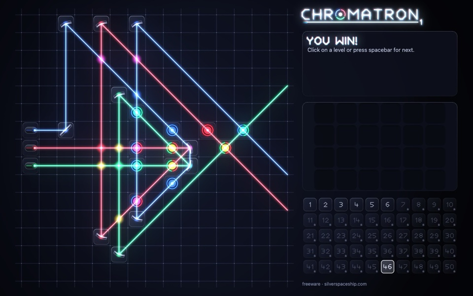
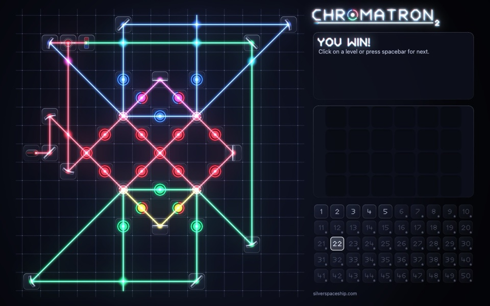
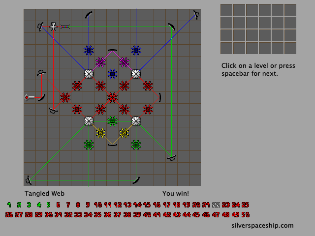
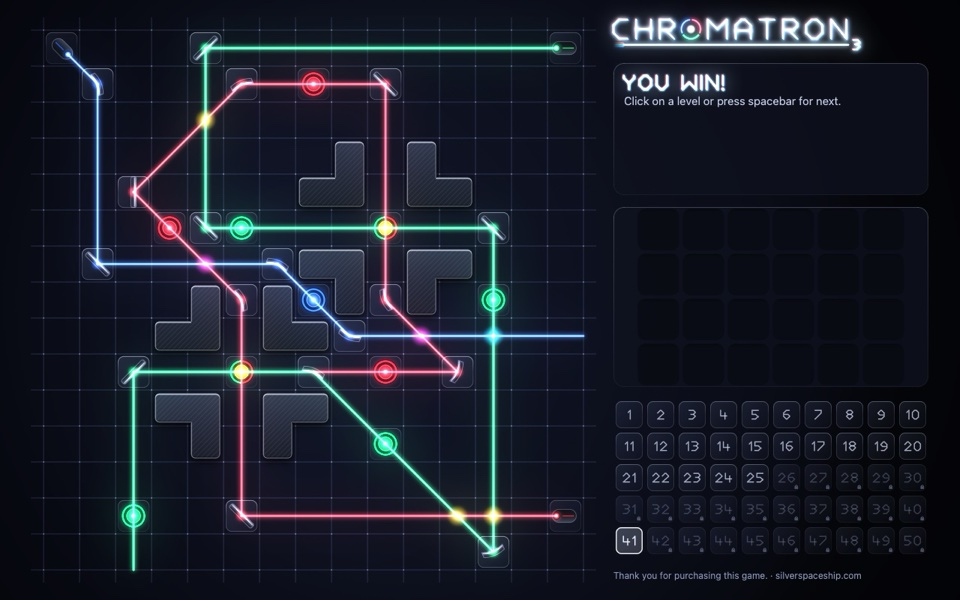
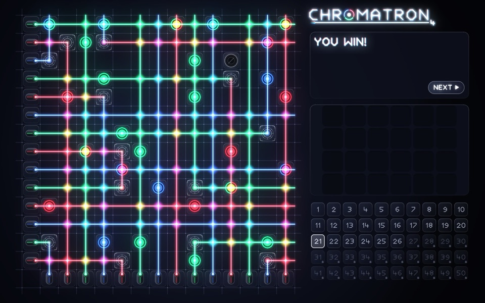

+++
authors = ["Shengtuo Hu"]
title = "Playing Chromatron Again, Twenty Years Later"
description = "I played Chromatron with my dad around 2006. Twenty years later, Claude Code ported all four games to Apple Silicon and the browser while I played and sent feedback."
date = 2026-10-11T18:00:00-07:00
[taxonomies]
tags = ["Chromatron", "Claude Code", "Reverse Engineering", "Rust", "Games"]
[extra]
card = "card.png"
card_fit = "fill"
banner = "banner.jpg"
+++

Around 2006, my dad and I played a little puzzle game called Chromatron. You get a
few lasers, some mirrors and colour filters, and a board of targets that light up
when the right colour of light reaches them.

The version we played was not Sean Barrett's original, though. It was a Flash
port by Hawkpeng79, and it only covered the first Chromatron, split into two
Flash games of 25 levels each. That is why, for twenty years, I never knew there
were three more.

Recently I wanted to play it again. Sean Barrett's site still has all four
Chromatron games up for download, and three of them were new to me. None of
them would open on my Mac. By the next evening I was playing all four, and the
early levels of the first game came back as pure muscle memory: my hands knew
where the mirrors went before I had really looked at the board.

I did not write a single line of code for this. Claude Code did. This post is
about how that went, from the point of view of the person who mostly played.

**Play it here: [shengtuo.me/chromatron-remake](https://shengtuo.me/chromatron-remake/)**,
all four games, phones included. The code is on
[GitHub](https://github.com/h1994st/chromatron-remake), and the native Apple
Silicon apps are on its
[release page](https://github.com/h1994st/chromatron-remake/releases/tag/v1.0.0).



The trailer. Its puzzles were made new for the video, not taken from the original levels.

## Why the old games stopped working

The Mac versions of Chromatron came out in 2003 and 2004, built for PowerPC.
Apple moved to Intel in 2006 and kept PowerPC apps running through Rosetta for a
few more years, until Mac OS X Lion dropped it in 2011. On an Apple Silicon Mac
today, the original apps are icons that refuse to launch.

## The game in one picture

<figure class="f-figure f-figure--bare">

<figcaption>Steer coloured lasers with mirrors and filters, and mix the light so every target gets exactly its colour.</figcaption>
</figure>

Each level gives you some fixed pieces and a toolbox of movable ones. You drag
them onto the grid and turn them in 45° steps. Light mixes the way light does, so
red and green make yellow, and a target only lights up when it gets exactly its
own colour. A level is solved when every target is lit at the same time. Each
sequel adds stranger pieces: twisters in Chromatron 2, quad-benders in 3, logic
gates and teleporters in 4.

<button type="button" data-variant="modern" aria-pressed="true">Modern</button>
<button type="button" data-variant="classic" aria-pressed="false">Classic</button>

<ul class="f-gallery">
<li>Chromatron</li>
<li>Chromatron 2</li>
<li>Chromatron 3</li>
<li>Chromatron 4</li>
</ul>

The web version got a new look a few days after the first release: beams sweep
out from their lasers, targets flash as they light up, and pieces lift and turn
as you move them. The classic look is still there, the way I remember it. Flip
the switch above to compare, or use **Actions ▸ Classic look** in the game. The
Mac apps keep the classic look.

## Claude Code did the engineering

I gave Claude Code the four original apps and a short brief: make them run
natively on my Mac, faithful to the originals, with the same rules, levels,
sprites and text. I added two ground rules. Everything had to come from our own
reading of the original programs, not from anyone else's work. And the game's
data stays out of the repository.

From there, Claude did all of the engineering:

- It ran Ghidra on the command line to decompile the PowerPC code into C.
- Subagents read through the decompiled output and wrote notes on how each game
  works, about 6,800 lines across the four games. Games 2 to 4 were worked out
  by comparing them against game 1.
- It wrote a design, split the work into plans, and built the Rust code one task
  at a time, with a separate reviewer checking each task.

The first game was playable on my Mac the same night. All four Mac apps shipped
the next evening, and the browser version the morning after that.

Lately a project called [REA (Reverse Engineer Anything)](https://github.com/morluto/rea)
has been trending on GitHub. It connects coding agents like Claude Code to Ghidra,
IDA Pro and Hopper so they can take a program apart and rebuild it. Chromatron
Remake did not use REA; Claude Code just drove Ghidra from the command line. But
it is the same idea, and seeing both at once made it click for me: an old program
you can no longer run does not have to be the end of it.

## How it fits together

<figure class="f-figure f-figure--bare">
<picture>
<source media="(max-width: 600px)" srcset="how-tall.svg" width="360" height="700">

</picture>
<figcaption>Drawn as a Chromatron board: the original game is the white light, the Rust engine is the prism, and the green beam is me.</figcaption>
</figure>

What I like most as a player is that there is one engine underneath everything.
The four Mac apps and the web page share the same rules, levels and drawing code,
so once the Mac version was right, the browser version was mostly new wiring
around it. Saves and copied solutions even use the original games' formats, so a
solution copied in the browser pastes straight into the Mac app.

The repository itself contains no game data. The build reads the levels, graphics
and text from the original apps, downloaded from Sean Barrett's site. The apps on
the release page and the web version do include that data once built, which is
why the credit at the end of this post matters to me.

## My job was to play

My part was being the player, especially for the web version. Some of what I ran
into, none of which a test caught:

- In WeChat's in-app browser, the toolbox filled the whole width of the screen
  and the page would not scroll.
- Right-click turns a piece the other way, but in the browser it opened the
  context menu instead.
- On a phone, the piece you drag floats a little above your finger so you can
  see it, which made it impossible to start a drag near the top of the board.

Each one went over as a message from me and came back as a release, most of
them on that third day.

## Small things it found along the way

A few things turned up inside the original programs that I would never have
known about otherwise:

- Chromatron 1 has 62 levels inside it, but only 50 are playable. The other 12
  are still there, and they still solve.
- Chromatron 3's unused levels have placeholder names like "level005", with hints
  that just say "foobar" and "blah".
- The "silverspaceship.com" at the bottom of the screen is not stored as plain
  text. Each byte is XORed with the one before it, the same way in all four games.

## Thank you, Sean

Chromatron is Sean Barrett's game. The design, the levels, the graphics and the
text are all his, from Silver Spaceship Software, and you can still get the
originals from [silverspaceship.com/chromatron](https://silverspaceship.com/chromatron/).
Thanks also to Hawkpeng79, whose Flash port is how I found the game in the
first place.

> [!NOTE]
> Chromatron Remake is an unofficial, independent port. It is not affiliated
> with or endorsed by Sean Barrett or Silver Spaceship Software. If he would
> like it taken down, I will take it down.

If you played Chromatron back then too,
[give it a try](https://shengtuo.me/chromatron-remake/). Your hands might remember
more than you expect.
